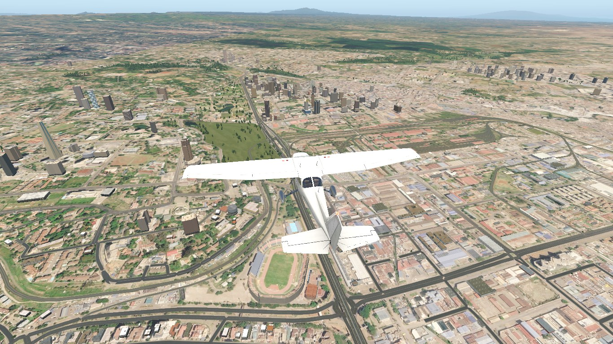
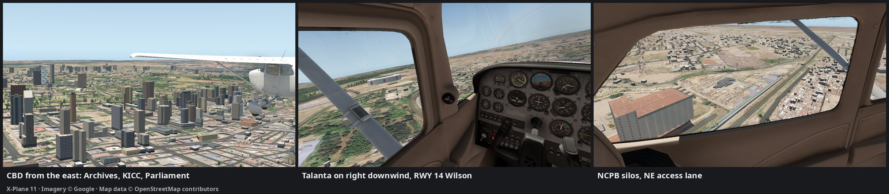
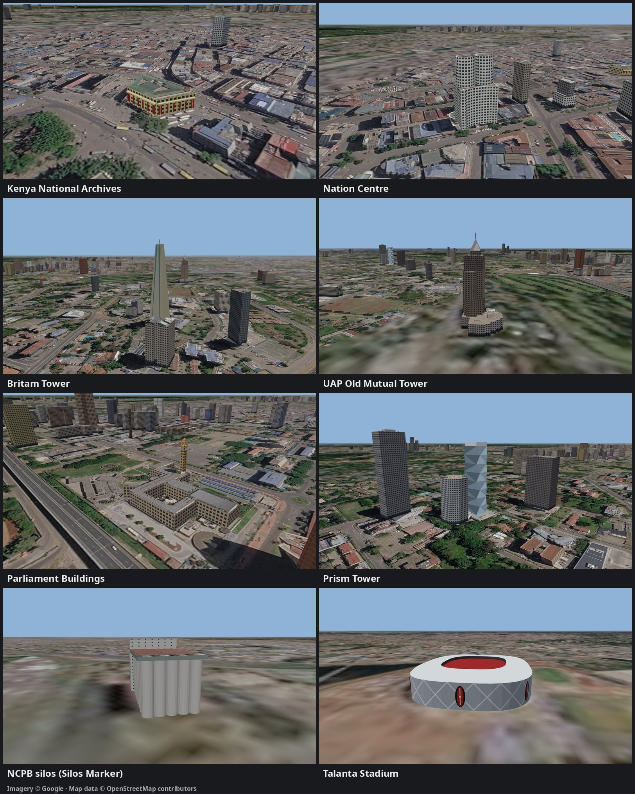

# HKNA VFR Landmarks

X-Plane 11 overlay with 3D landmarks for VFR flying in the Nairobi region (HKNW / HKJK),
covering tiles -02+036 and -02+037.

- **Towers.** Upper Hill, CBD and Westlands towers: UAP Old Mutual, Britam, GTC, Teleposta, Prism, Bunge and others.
  - Every OSM building of 55 m or more is modelled from its real footprint and height.
  - Windows light up at night, and anything 60 m or taller has red obstruction lights.
  - KICC, Times Tower and the Hilton are left to simHeaven X-Africa-1-vfr's own hand-made models if that pack is installed (found via `XP_CUSTOM_SCENERY`). Otherwise they're modelled from OSM like the rest.
- **Colours from the imagery.** Colours come from the same Ortho4XP imagery the sim shows.
  - Roofs are textured with the imagery. Each tower's roof is found in the leaning imagery by edge matching.
  - Facade colours are sampled from the visible facades.
  - Extras: shopfront ground floors, rooftop plant rooms and AC units where the imagery roof isn't usable, and stadium floodlights.
- **CBD landmarks.** Low-rise national landmarks, modelled whatever their height. Facade directions are checked against the OSM streets, and details and colours come from street-view screenshots:
  - Kenya National Archives: red columns with gold capitals on the City Hall Way and Moi Avenue fronts.
  - Parliament: the courtyard block, plus the clock tower with its clock faces, open lantern and crown.
  - City Hall: brown stone, with a white-pillared portico on City Hall Way.
  - Jamia Mosque: grey-stone prayer hall with three silver domes, two minarets and two turrets; white courtyard ranges; a green-domed gate on Banda Street.
  - McMillan Library: portico and pediment facing Banda Street.
  - Nairobi Railway Station: gabled roof, with an arcade facing Station Road.
- **Stadiums and silos.** Nyayo, Kasarani and Talanta stadium bowls, and the NCPB grain silos (40 bins plus the elevator tower).
- **Wind farm.** Ngong Hills wind farm, 30 turbines. It needs OpenSceneryX; simHeaven's duplicate turbines are excluded.
- **AIP visual references (HKNW AD 2.22):**
  - Langata Barracks (RWY 07 final)
  - MONASTERY FINAL
  - KDF Memorial Hospital (RWY 14)
  - KBC Ngong masts (WHISKY 1)
  - Visual Marker beacon
  - Silos Marker
  - Ndula Marker (checkered roof)
  - Twin Bridges (striped parapets)
  - LORESHO water towers (a generic model at both AIP positions)

## Screenshots

In X-Plane 11 over Ortho4XP GO2 imagery, looking north from above Nyayo Stadium: Upper Hill on the left, the CBD ahead, Westlands on the horizon to the right.



Low passes in the sim:



Full size: [CBD](docs/img/sim-cbd.jpg) · [Talanta](docs/img/sim-talanta.jpg) · [NCPB silos](docs/img/sim-silos.jpg)

The landmark shots below are from the built-in viewer (`./view.sh`), over the same imagery. Imagery © Google; map data © OpenStreetMap contributors.



Full size: [Archives](docs/img/archives.jpg) · [Nation Centre](docs/img/nation-centre.jpg) · [Britam](docs/img/britam.jpg) · [UAP Old Mutual](docs/img/old-mutual.jpg) · [Parliament](docs/img/parliament.jpg) · [Prism](docs/img/prism.jpg) · [NCPB silos](docs/img/silos.jpg) · [Talanta](docs/img/talanta.jpg)

To retake them: `tools/viewer/shot.sh out.png "at=<lat>,<lon>,<height>&az=<deg>&el=<deg>&dist=<m>&clean=1" 1600,900`. `az` is the bearing from the target to the camera. `clean=1` hides the panels. `docs/img/gallery.jpg` is put together from the single shots.

## Imagery: go2 or open

The models' roof textures and facade colours come from satellite imagery. Choose the source with `IMAGERY` in `build.local.sh`:

| `IMAGERY=` | Source | Licence |
|---|---|---|
| `go2` (default) | Your Ortho4XP tile's own textures (Google) | Google's terms: personal use, don't redistribute |
| `open` | Maxar 30 cm satellite, May 2024 (May 2019 where 2024 doesn't cover), from OpenAerialMap | CC BY-NC 4.0: free for non-commercial use, with credit |

**Use `go2` unless you need an open licence.** It is the same image X-Plane drapes on the ground under the models, so roofs and colours match their surroundings seamlessly. It's already on disk, so builds don't download anything.

**Use `open` if you want to share the pack, or keep it free of Google imagery.** Three drawbacks:
- **Mismatch with the ground.** The roofs won't quite match the sim's ground unless your Ortho4XP tiles are built from the same imagery.
- **Steep viewing angle.** The 2024 image was shot far off vertical: towers lean about 0.7 m north-west per metre of height. Tall towers' roofs and facade colours are therefore less reliable; the build corrects for it, but not perfectly.
- **Download time.** The first build downloads a few thousand tiles (about 10–15 minutes) into `imagery_cache/`; later builds reuse them.

If `IMAGERY` isn't set, the build uses `go2` when `ORTHO_TEX` points at your Ortho4XP textures. Without them it falls back to `open`, and says so.
If you fly over Ortho4XP tiles, build -02+036 with Ortho4XP (provider GO2) and set `ORTHO_TEX` rather than relying on the fallback. The models then match the ground you actually see. Ortho4XP also fetches the imagery once, in bulk, instead of each build pulling thousands of tiles from OpenAerialMap's slow, rate-limited tile server.
`IMAGERY=go2` without `ORTHO_TEX` stops with an error rather than silently switching.

## Previewing without X-Plane

`./view.sh` opens a three.js preview of the built pack in the browser. It shows the same objects on the same Ortho4XP imagery, with a viewpoint for every landmark (`./view.sh "City Hall"` opens at one).
After another `./build.sh`, press Reload (or R) in the page. "Link view" puts the camera in the address bar, so a view can be shared or reopened.
`tools/viewer/shot.sh out.png "lm=Jamia Mosque&az=160&el=20"` takes a headless screenshot on the iGPU. It never uses software rendering.

To drop buildings from the pack, click one in the viewer and press **Remove** (or Del). It turns red, and its id is written to `source/removed.txt`, which `build.py` skips.
**Rebuild** runs `./build.sh` and reloads. Restore a building from the Removed tab, or delete its line from `source/removed.txt`.
The Objects and Buildings tabs list everything sorted by triangles or vertices.

### Camera match and editing buildings

To line a building up against a photo:
1. Select it and press **+ Photo**. Drop in a photo and paste its Street View URL, which fills the camera position, heading, tilt and field of view. Or type the pose in yourself.
2. **Match mode** puts the 3D camera at that pose and overlays the photo. Tune it with the sliders, or the keys: arrows for heading and tilt, [ ] for field of view, PgUp/PgDn for height, Space to flip between photo and model.
3. **Trim top/bottom** cuts off browser bars in screenshots. **Save pose** remembers the alignment. Fetched photos with a known position open in match mode from their full view ("match in 3D").

**Edit** changes a building's height, wall colour (the **Eyedropper** picks it from the photo), glass facade, and the shape settings of specially modelled buildings. Edits are saved to `source/overrides.json`, which is in git and applied over the built-in settings.
**Save & rebuild**, or **Rebuild**, runs `./build.sh` and shows its stages and log as it goes. The page then reloads and stays in the matched view, so you can compare straight away.
Your photos are stored in `photos/user/`, which isn't in git.
To remove a photo, for example one added to the wrong building, open it and click **remove photo** in the caption. Your uploaded file is deleted. A fetched photo only comes off that building's list.

### Improving a building with Claude Code

Shapes the Edit panel can't make, such as drums, tapers, crowns or a missing ground floor, are code in `source/build.py`. [Claude Code](https://claude.com/claude-code) can write that code from your photos. Open it in this repo and give it the photos as follows:

1. In `./view.sh`, select the building and add **2–4 Street View screenshots** with **+ Photo**, from different sides if you can. Paste each one's Street View URL so it gets a camera pose. Cover the part that's wrong. For a crown or rooftop feature, also add a distant shot that shows the whole height against neighbouring buildings.
2. Note the building's **id** from the info card (e.g. `id 1408601890`). If the building is in several OSM parts, add the photos to the part that's wrong, or mention both ids.
3. Ask, naming the building, its id and what's wrong. For example:
   - `The Nation Centre cylinders are floating; there's no ground section under them. I've added photos to id 123355543.`
   - `The Nation Centre cylinders are too short. Check the new photos on id 1408601890.`
   - `Prism Tower should zig-zag more, and its crown is an open white frame. I've added 3 photos to id 1189990505.`
   - `The CBK Pension Towers podium glass should be bluer. New photo on id 699395720.`

   Say "check new images" when you've added more photos to a building that's been worked on before.
4. Claude reads the photos from `photos/<id>.json` and `photos/user/` and checks the OSM tags. It changes `CORE_SPEC` or adds a builder in `build.py`, runs `./build.sh`, and checks its work with camera-matched overlays (`tools/viewer/shot.sh … "bld=<id>&match=<photo file>&opacity=0.5"`). Ask to see the overlays if you want to judge them yourself.
5. Look at the result in the viewer (**Reload**), then restart X-Plane. If it's still off, say what's wrong and add a photo that shows it.

Tips:
- Screenshots that include browser bars are fine. Claude sets **trim top** for them, or you can set it in match mode.
- Keep the request to one building at a time. Ask for low-poly shapes: plain-colour facets beat detailed geometry for VRAM.
- Name the street and side you photographed from if the Street View URL is missing. Without a pose, a photo can only be compared by eye.
- A photo on the wrong building is misleading. Remove it (see above) before asking.

### Reference photos (open licences only)

`tools/fetch_photos.py` fetches photos of the named landmarks and towers. `tools/fetch_photos.py <id> …` fetches particular buildings, and `--all` fetches every one.
It downloads them into `photos/`, which isn't in git because the images belong to their authors.
Sources are Wikimedia Commons, and Mapillary if `MAPILLARY_TOKEN` is set in `build.local.sh`; both are openly licensed. It never uses Google.
In the viewer, a selected building shows its photos. Click one for the full image with its author, licence and source link. Orange markers show where each camera stood.

## Landmark positions

These are generated by `./build.sh` from the same data the scenery is built from.
To fly to one, use `python3 tools/xpplace.py <lat> <lon> <alt_ft> <heading> [speed_kt]` (an instant VEHX teleport over UDP 49000; add `--physics` for a slower PREL "start here" that keeps the flight model running).
The AIP visual references have presets, e.g. `python3 tools/xpplace.py whisky1`; `python3 tools/xpplace.py list` shows them all.

<!-- landmarks:begin -->
### Towers

| Landmark | Lat | Lon | Notes |
|---|---|---|---|
| Britam Tower | -1.30001 | 36.81321 | 200 m |
| Eigthy-eight | -1.29277 | 36.80759 | 150 m |
| Prism Tower | -1.29310 | 36.80890 | 133 m |
| Bunge Tower | -1.29137 | 36.82052 | 125 m |
| GTC Apartments | -1.26919 | 36.80780 | 114 m |
| CBK Pension Towers | -1.29035 | 36.82312 | 110 m |
| Le'Mac | -1.26164 | 36.78965 | 110 m |
| GTC Residence | -1.26931 | 36.80831 | 107 m |
| Pan Pacific Serviced Suites | -1.26982 | 36.80884 | 107 m |
| 316 Upper Hill Chamber | -1.29325 | 36.81016 | 104 m |
| Social Security House | -1.29005 | 36.81188 | 103 m |
| pan pacific suites | -1.26989 | 36.80818 | 100 m |
| Kenya Commercial Bank Plaza | -1.30171 | 36.81283 | 100 m |
| Sanlam Tower | -1.26101 | 36.79108 | 88 m |
| Nyayo house | -1.28709 | 36.81811 | 84 m |
| National Bank Houe | -1.28866 | 36.82548 | 82 m |
| Anniversary Towers | -1.28164 | 36.81634 | 80 m |
| The Marquis Apartments A | -1.28057 | 36.78004 | 80 m |
| The Marquis Apartments B | -1.28093 | 36.77975 | 80 m |
| 4th Avenue Towers | -1.29335 | 36.80847 | 76 m |
| Alba Garden A | -1.29062 | 36.79271 | 73 m |
| Alba Garden B | -1.29062 | 36.79324 | 73 m |
| The Address | -1.25949 | 36.78058 | 73 m |
| afya center | -1.28794 | 36.82794 | 73 m |
| Uchumi House | -1.28666 | 36.82522 | 71 m |
| Toti Apartments | -1.36288 | 36.92580 | 70 m |
| Elite Residence | -1.27039 | 36.81041 | 70 m |
| FCB Mihrab | -1.28975 | 36.78730 | 70 m |
| Kings Distinction Residential | -1.29379 | 36.79288 | 70 m |
| Casamia Apartments | -1.29987 | 36.79454 | 66 m |
| Diamond Plaza 2 | -1.25856 | 36.81920 | 66 m |
| Riya Residence | -1.26456 | 36.81722 | 66 m |
| Serenity Residency | -1.30065 | 36.77885 | 66 m |
| The World Bank Group | -1.30050 | 36.81175 | 66 m |
| International House Ltd | -1.28586 | 36.82383 | 65 m |
| Delta Corner tower A | -1.26563 | 36.80207 | 63 m |
| Delta Corner tower B | -1.26596 | 36.80199 | 63 m |
| GoldPark Homes | -1.29014 | 36.78568 | 63 m |
| Golden Towers | -1.25447 | 36.81326 | 63 m |
| HH Towers | -1.28339 | 36.82319 | 63 m |
| Hilal Residency | -1.25901 | 36.81688 | 63 m |
| Imagine Luxury Apartments by Dominion | -1.29609 | 36.78599 | 63 m |
| Nova Apartments | -1.25963 | 36.78156 | 63 m |
| Pension Towers | -1.28364 | 36.81793 | 63 m |
| Platinum Oak Residency A | -1.28974 | 36.77557 | 63 m |
| Platinum Oak Residency B | -1.28946 | 36.77559 | 63 m |
| SHA Building | -1.29472 | 36.81267 | 63 m |
| Shams Residency A | -1.25810 | 36.81526 | 63 m |
| Shams Residency B | -1.25833 | 36.81506 | 63 m |
| Skynest Residences | -1.26156 | 36.80466 | 63 m |
| Winchester Gardens Amazing Homes | -1.26783 | 36.78897 | 63 m |
| Wood Avenue Towers | -1.29293 | 36.78567 | 63 m |
| Highway Heights | -1.29357 | 36.79069 | 61 m |
| Jkuat towers | -1.28423 | 36.82102 | 61 m |
| Cassia Court | -1.30330 | 36.82162 | 59 m |
| City View House | -1.27415 | 36.82179 | 59 m |
| Cottingham Park | -1.29631 | 36.77966 | 59 m |
| Danaff Tower Apartments | -1.27955 | 36.79300 | 59 m |
| Heartland Homes Garden A | -1.29802 | 36.79239 | 59 m |
| Heartland Homes Garden B | -1.29836 | 36.79241 | 59 m |
| Himalaya Heights | -1.29834 | 36.78914 | 59 m |
| Hyatt House Nairobi Westlands | -1.26013 | 36.80289 | 59 m |
| Hyatt Regency Nairobi Westlands | -1.26754 | 36.80810 | 59 m |
| Jade Residency A | -1.29802 | 36.79265 | 59 m |
| Jade Residency B | -1.29836 | 36.79267 | 59 m |
| Jumeirah Heights | -1.26276 | 36.81881 | 59 m |
| Lana Plaza | -1.28959 | 36.77692 | 59 m |
| Roseville Apartments - Kilimani | -1.29655 | 36.79471 | 59 m |
| Royal Oaks Residency A | -1.29136 | 36.77513 | 59 m |
| Royal Oaks Residency B | -1.29137 | 36.77485 | 59 m |
| Staroot Residency A | -1.29198 | 36.78562 | 59 m |
| Staroot Residency B | -1.29199 | 36.78529 | 59 m |
| Staroot Residency C | -1.29169 | 36.78525 | 59 m |
| Staroot Residency D | -1.29165 | 36.78556 | 59 m |
| West Peak Apartments | -1.28452 | 36.78062 | 59 m |
| Yaya Hotel & Apartments | -1.29309 | 36.78841 | 59 m |
| Chelezo Apartments | -1.29753 | 36.79069 | 56 m |
| Denis Gardens Apartments | -1.28638 | 36.78511 | 56 m |
| Fahari Hill | -1.30334 | 36.82010 | 56 m |
| Muthaiga Square | -1.26133 | 36.84236 | 56 m |
| Talanta Plaza | -1.30133 | 36.81463 | 56 m |
| The Curve By The Park | -1.32689 | 36.84320 | 56 m |
| Trade Development Bank Tower | -1.28997 | 36.78460 | 56 m |
| Valley Heights Apartments | -1.29033 | 36.77493 | 56 m |
| Utalii House | -1.28326 | 36.81619 | 55 m |

### Landmarks

| Landmark | Lat | Lon | Notes |
|---|---|---|---|
| ABC Place | -1.25949 | 36.77787 | 46 m |
| Safaricom House | -1.25925 | 36.78610 | 36 m |
| Safaricom House 2 | -1.25897 | 36.78546 | 34 m |
| Kenya Parliament Buildings | -1.28990 | 36.81998 | 15 m |
| Nairobi City Hall | -1.28672 | 36.82137 | 15 m |
| Kenya National Archives | -1.28493 | 36.82596 | 14 m |
| Jamia Mosque | -1.28331 | 36.82084 | 12 m |
| McMillan Library | -1.28353 | 36.82119 | 10 m |
| Nairobi Central Railway Station | -1.29165 | 36.82856 | 6 m |

### Stadiums

| Landmark | Lat | Lon | Notes |
|---|---|---|---|
| Talanta Stadium | -1.30598 | 36.74962 | 38 m stands |
| Kasarani Stadium | -1.22994 | 36.89242 | 30 m stands |
| Nyayo National Stadium | -1.30397 | 36.82469 | 22 m stands |

### AIP visual references (HKNW AD 2.22)

| Landmark | Lat | Lon | Notes |
|---|---|---|---|
| KBC Ngong mast 75 m (WHISKY 1) | -1.32576 | 36.67487 | 75 m |
| NCPB silos (Silos Marker, NE access lane) | -1.30553 | 36.88611 | 42 m bins, 54 m tower |
| KBC Ngong mast 50 m (WHISKY 1) | -1.32910 | 36.67712 | 50 m |
| LORESHO water tower (State House departure) | -1.23417 | 36.71278 | generic, 30 m |
| LORESHO water tower (north arrival) | -1.22867 | 36.70250 | generic, 30 m |
| KBC Ngong mast 25 m (WHISKY 1) | -1.32549 | 36.67759 | 25 m |
| Visual Marker beacon, Africa Nazarene Univ. (SE access lane) | -1.40000 | 36.78928 | 12 m, 100 ft circle |
| Kenya Defence Forces Memorial Hospital | -1.31064 | 36.80454 | 60 buildings; RWY 14 approach, cross >= 5900 ft |
| St. Thomas Aquinas Seminary (MONASTERY FINAL, 3 NM RWY 07) | -1.34877 | 36.75780 |  |
| Langata Barracks | -1.33252 | 36.79274 | 425 buildings; RWY 07 final ~0.9 NM |
| Ndula Marker (checkered roof, NE access lane) | -1.03245 | 37.24777 | tile -02+037 |
| KBC Ngong transmitter (WHISKY 1) | -1.32697 | 36.67700 | 18 buildings |
| Twin Bridges marker (SE access lane) | -1.57373 | 36.92896 | striped parapets |

### Other

| Landmark | Lat | Lon | Notes |
|---|---|---|---|
| Times Tower (simHeaven X-Africa's hand-made model) | -1.29051 | 36.82392 | not modelled here |
| KICC (simHeaven X-Africa's hand-made model) | -1.28872 | 36.82305 | not modelled here |
| Hilton (simHeaven X-Africa's hand-made model) | -1.28529 | 36.82460 | not modelled here |
| Ngong Hills wind farm (30 turbines, centre) | -1.38294 | 36.63759 | 50 m hubs |

<!-- landmarks:end -->

## Notes

- **Exclusions.** simHeaven's generic objects and facades are excluded under every model, and inside the barracks, hospital and KBC boundaries (trees are kept).
- **simHeaven's hand-made models** are never excluded or duplicated: `build.py` drops any exclusion box within 60 m of them.
- **Object setting.** The DSFs carry `sim/require_object 1/0`, so the objects draw at any "number of world objects" setting. Without it, X-Plane 11 only draws them at High and above.

## Layout and rebuild

This repo is the scenery pack. `Custom Scenery/HKNA_VFR_Landmarks` is a symlink to it.
`objects/` and `Earth nav data/` are generated by `./build.sh` and are not tracked in git.

```
./build.sh
```

- The Python dependencies (`requirements.txt`: numpy, Pillow, shapely) are installed into a venv in `.venv/`, which is not tracked in git. `build.sh`, `view.sh` and `shot.sh` create it on first run and reinstall when `requirements.txt` changes. Set `VENV=/path/to/venv` in `build.local.sh` to use another one.
- `source/osm_fetch.py` downloads the OSM data on the first build and caches it in `source/osm/`, which is not tracked in git.
  - Later builds reuse that cache, so the scenery doesn't change under you. Run `python3 source/osm_fetch.py source/osm --refresh` to pull fresh data.
  - Overpass throttles heavily. If a first build fails with 502/504 errors, just run it again later.
- `source/build.py` does the work: features, imagery sampling, the texture atlas, the OBJs, and the DSF text for each tile.
- The X-Plane scenery tools (DSFTool and DDSTool) are fetched to `~/.cache/xptools` if they're missing.
- Imagery comes from `ORTHO_TEX`, which defaults to the Ortho4XP fork's `zOrtho4XP_-02+036/textures`.

## Sources and licensing

- **Code.** The build scripts and tools in this repo are under the MIT License (see `LICENSE`).
- **OpenStreetMap.** Building footprints, heights, stadiums, turbines and sites are © OpenStreetMap contributors, under the [ODbL](https://opendatacommons.org/licenses/odbl/1-0/).
  - No OSM data is stored in this repo. `source/osm_fetch.py` downloads it from Overpass on the first build and caches it locally in `source/osm/`.
  - Scenery built from them must carry the attribution "© OpenStreetMap contributors".
- **Imagery, which is not included.** Roof textures and facade colours are sampled at build time (see "Imagery: go2 or open").
  - **`IMAGERY=go2`:** from *your own* Ortho4XP tiles (`ORTHO_TEX`). Those usually come from commercial providers whose terms don't allow redistribution. **Do not publish or share a pack built this way** (`objects/`, `Earth nav data/`). Share this repo, and let others build it against their own tiles.
  - **`IMAGERY=open`:** Maxar imagery via [OpenAerialMap](https://openaerialmap.org), [CC BY-NC 4.0](https://creativecommons.org/licenses/by-nc/4.0/). A pack built this way can be shared non-commercially, credited "Imagery © Maxar, via OpenAerialMap, CC BY-NC 4.0" (plus the OSM attribution). Tiles are cached in `imagery_cache/`, which isn't in git.
- **Screenshots.** The screenshots in `docs/img/` show the built pack over Google (GO2) imagery from Ortho4XP, and OSM data © OpenStreetMap contributors. They're here only to illustrate the pack. The imagery itself isn't included, and neither is a built pack.
- **Reference photos.** `tools/fetch_photos.py` downloads them into `photos/`, which isn't in git: Wikimedia Commons under each file's stated licence, and Mapillary under CC BY-SA 4.0. They're for checking models, and the viewer shows each one's author and licence.
- **simHeaven X-Africa.** Nothing from it is stored here. If it's installed, `build.sh` reads its placements at build time (via `XP_CUSTOM_SCENERY`). This is only to exclude its duplicate Ngong turbines and keep clear of its hand-made models.
- **AIP.** Visual reference points follow the Kenya eAIP, [HKNW AD 2](https://eaip.kcaa.or.ke/eAIP_19032026/19-03-2026/eAIP/HK-AD%202%20hknw-en-GB.html) (AD 2.22). Positions are published coordinates, or ones checked against street-level imagery.
- **Tools.** The X-Plane Scenery Tools (DSFTool, DDSTool) are downloaded from Laminar Research when you build. They aren't included here.
